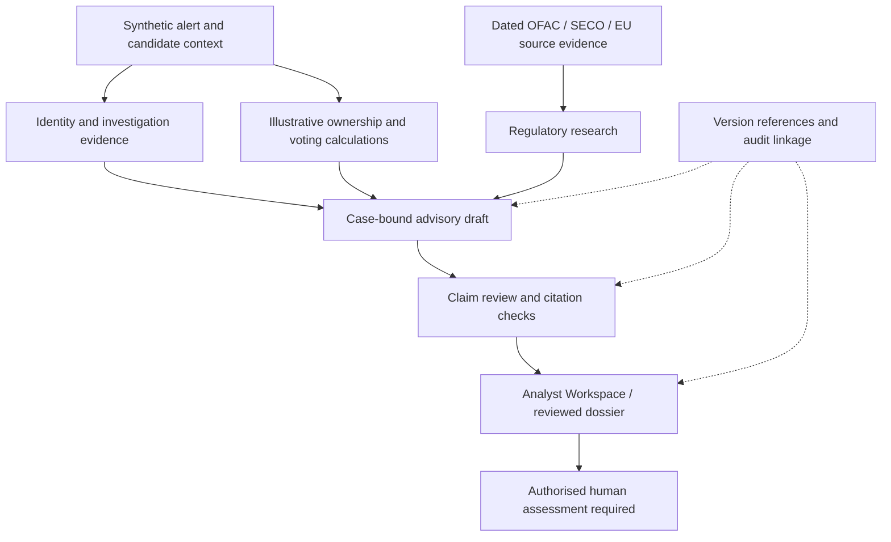

# Architecture and trust boundaries

Conceptual view based on the reported implementation. This is **not** a deployment architecture, security certification or proof of bank integration.

## Separation of responsibilities

| Layer | Role | Limit |
|---|---|---|
| Identity evidence | Preserve candidate differences, missing data and contradictions | High name similarity ≠ proven identity |
| Ownership arithmetic | Calculate illustrative economic and voting pathways | Not OFAC 50 Percent Rule attribution or EU/Swiss legal control |
| Regulatory evidence | Keep cited passages and source dates traceable | Citation integrity ≠ substantive support or current-law applicability |
| AI research draft | Assist with evidence organisation and questions | Can generate unsupported legal propositions |
| Reviewer and report | Retain claim assessments, rationale, citations and case-bound audit evidence | Reviewer `SUPPORTED` ≠ verified current-law finding |
| Human oversight | Keep case open for review and escalation | No automated clearance or payment release |

The frozen historical-evidence workflow intentionally emits `supported_legal_findings=[]` while retaining claim reviews. Additional current-law verification and jurisdictional assessments were not accepted in this phase.

## Out of scope

Production authentication, bank-system integration, real-time regulatory currency, complete sanctions-list applicability, independent legal sign-off, production monitoring and UK legal-source ingestion are **not established**.
